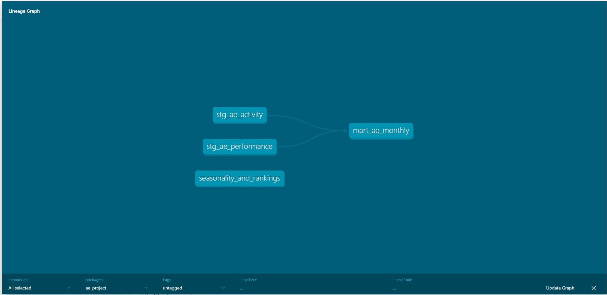
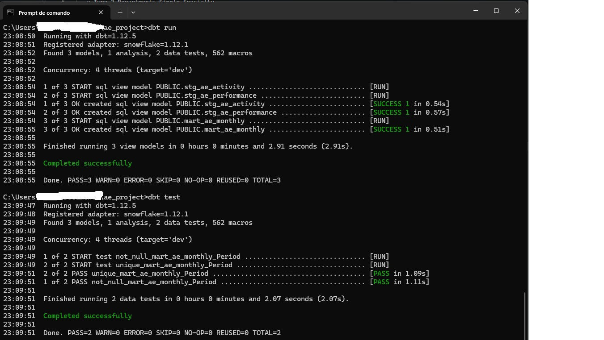
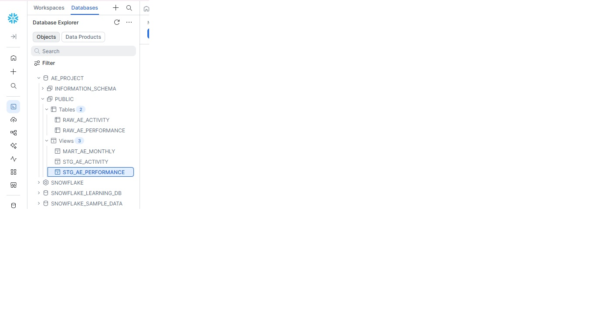

# NHS A&E 4-hour performance pipeline (Snowflake, dbt, Power BI)

A personal learning project in which I took NHS England's monthly A&E data through a small data pipeline. I loaded the raw data into Snowflake, cleaned and joined it with dbt and SQL, added basic data tests, and visualised the results in Power BI. It shows how 4-hour A&E performance, attendances and emergency admissions have changed since 2010.  I built it while learning, with step-by-step guidance from an AI assistant, and I ran and checked every step myself.

## Data source

NHS England, "Monthly A&E Time Series" workbook, from the A&E Attendances and Emergency Admissions page:
https://www.england.nhs.uk/statistics/statistical-work-areas/ae-waiting-times-and-activity/

I used the edition with data up to August 2026. NHS England replaces this file monthly, so the page currently shows a newer edition. The CSV extracts I used are saved in this repository.

I used two tabs:

- Activity: attendances and emergency admissions, from August 2010.
- Performance: attendances seen within or over 4 hours, and the 4-hour percentages, from November 2010.

I did not use the Booking tab.

## How the pipeline works

- Raw data: the two tabs were uploaded as CSV files into Snowflake (`RAW_AE_ACTIVITY` and `RAW_AE_PERFORMANCE`), with all values loaded as text.
- Staging (dbt): `stg_ae_activity` and `stg_ae_performance` turn the month into a date, remove commas and percentage signs, and convert the text into numbers.
- Mart (dbt): `mart_ae_monthly` joins the two on the month, with a full outer join, so no month is lost. The percentages are blank for the first three months, because the Performance data starts in November 2010.
- Tests (dbt): `unique` and `not_null` on the month column.
- Analysis and dashboard: 6 SQL queries in `analyses/`, and a two-page Power BI dashboard (`ae_performance_dashboard.pbix`).

## Design choices and caveats

- Raw data is loaded as text and converted in the staging models, so the cleaning is visible in the code.
- Unreadable values become blank, instead of causing an error. Blanks in the 12-hour column are set to 0, which assumes that a blank means no waits.
- Percentages are on a 0 to 100 scale.
- Figures from Nov 2010 to May 2015 are estimated from weekly data. From May 2019 to May 2023, the 4-hour performance data excludes the 14 trusts that field-tested new performance standards (the Clinical Review of Access Standards, CRS). The source says to take care when comparing these months with others.
- Activity data from August 2020 includes booked appointments. A cyber-attack on several Type 3 providers left a shortfall in total and Type 3 attendances from August 2022 to February 2023. I have not flagged these periods in the data, so attendance-based comparisons across them should be read with caution.
- 2010 and 2026 are partial years, and yearly figures are averages of the monthly values, not weighted by patient numbers.

## Findings

- 4-hour performance fell from about 97% in 2010 to about 75% in 2026, with the sharpest drop between 2020 and 2022 (from about 87% to about 71%). The lowest month was December 2022 (with 65.2%).
- Across all years, December has the lowest 4-hour performance and May the highest, but the long-term trend matters much more than the season.
- Per day, January is the quietest month for attendances and June the busiest. February's low monthly total is mostly because it is a shorter month.
- Emergency admissions via A&E were about 17%-19% of attendances in most years, peaking at about 22.9% in 2020, when attendances dropped. The data doesn't show why. Part of the 2020 rise may also come from the change in how attendances are counted from August 2020.

## Limitations and next steps

- The raw tables were loaded by hand, so they are not declared as dbt sources. Declaring them would let the lineage start at the raw data.
- The project ran on a 30-day Snowflake free trial, which has now ended. To re-run it, you need your own Snowflake account and a `profiles.yml` (not included here, because it holds login details).

## How to run it

Load the two CSV files into Snowflake as `RAW_AE_ACTIVITY` and `RAW_AE_PERFORMANCE`, add your own connection details to `profiles.yml`, then run `dbt run` and `dbt test` from the project folder.